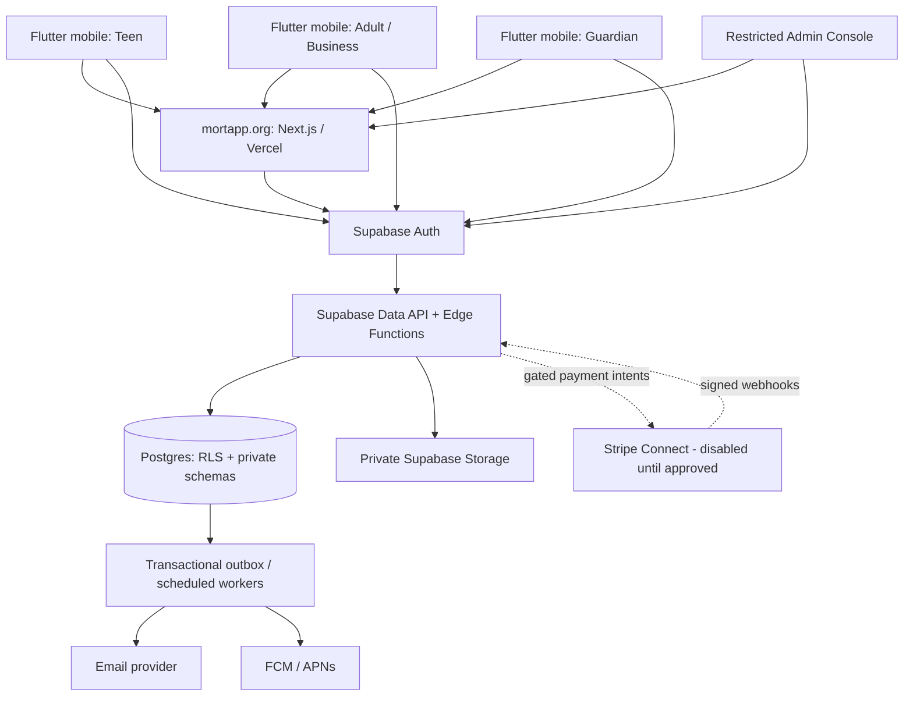

# MORT Production Reference Architecture

**Status:** Architecture baseline for implementation and verification  
**Date:** 2026-10-31  
**Production domain:** https://mortapp.org  
**Production Supabase project:** `mort p` / `jxbnrkasktbhtiujkhay`  
**Production web:** Vercel project `mort-web`, repository `mortapp/mort-web`, branch `main`  
**Production mobile source of truth:** `mortapp/Mort/flutter_mort`  
**Never use:** deleted Supabase project `rakjydmgwwgtdislanbt`

This document is the target architecture and implementation contract. It is not evidence that any component is already implemented. Codex must inspect the current code and database, map actual objects to this design, and report gaps before changing anything.

---

## 1. Product and operating principles

MORT is a teen-first local work marketplace for people ages 13–17 to discover and complete age-appropriate local jobs, with adults and businesses posting work. Guardians can participate in consent and oversight workflows where required by product policy, law, or job risk. Guardian access is explicit and scoped; it is not a blanket right to browse a teen's private activity. Admins operate safety, verification, moderation, disputes, and platform controls.

Architecture principles:

1. **Safety before liquidity.** No marketplace publishing, job acceptance, payments, or payouts until the relevant gate is independently verified.
2. **Server is authoritative.** Client-side role checks, distance calculations, status changes, payment amounts, and consent claims are never security boundaries.
3. **Least privilege.** Teen, adult, guardian, moderator, support, finance, and platform-admin capabilities are separate.
4. **Private by default.** Exact addresses, school details, identity documents, phone numbers, and private messages are not public marketplace data.
5. **Explicit lifecycle transitions.** Every important transition is validated server-side and recorded in an audit trail.
6. **Evidence over assertions.** A feature is complete only when code, database policy, automated tests, and an operational runbook agree.
7. **No schema guessing.** Existing production schema is authoritative. Do not replay the local migration chain or run broad compatibility SQL to make old clients pass.
8. **Fail closed.** Missing verification, consent, policy, webhook, or configuration state blocks the sensitive action.

## 2. System context and deployment topology

**Clients**
- Flutter app in `flutter_mort/` is the only production mobile client.
- Next.js site in `mort-web` is the production website and any web-based account/admin surfaces explicitly supported by the product.
- `app/`, `lib/`, `providers/`, `components/` legacy Expo paths and `swift_mort/` are reference-only unless a release decision explicitly changes this.

**Backend**
- Supabase Auth for identity and sessions.
- Postgres for authoritative state, constraints, RLS, transactional workflows, and audit records.
- Edge Functions for privileged operations, provider integrations, webhooks, and workflows that must not run in clients.
- Private Storage buckets for identity/verification evidence and restricted job/dispute attachments.
- Outbox-based notifications and provider delivery.

**Environment separation**
- Production web: `https://mortapp.org`.
- Production Supabase: `jxbnrkasktbhtiujkhay`.
- Sandbox payment credentials and webhook secrets must be clearly test-only and must never be mixed with live Stripe credentials.
- Preview/local/test builds must not silently use production data. Use explicit environment allowlists and fail closed on mismatches.
- Never contact, configure, or use `rakjydmgwwgtdislanbt`; it is deleted and is not a fallback.

## 3. Identity, roles, and authorization

### 3.1 Identity model

Use Supabase Auth user ID as the stable principal. Keep authorization facts in server-controlled profile/role tables or trusted app metadata, never in user-editable `user_metadata`.

Minimum domain concepts:
- `profiles`: account identity and lifecycle; minimal public-safe fields only.
- `role_assignments`: user-to-role grants, scope, grantor, timestamps, revocation.
- `verification_cases`: age/identity verification state, provider reference, reviewer, reason codes, timestamps; do not store raw ID images unless necessary.
- `guardian_relationships`: teen/guardian link, invitation state, verification, consent scope, expiry, revocation.
- `consent_records`: policy version, actor, subject, scope, method, evidence reference, timestamp, revocation.
- `admin_assignments`: explicit staff role, scope, expiry, and approval trail.

### 3.2 Roles

- **Teen:** browse eligible jobs, apply, message only in permitted job contexts, manage own profile, report/block, view own work and safety resources.
- **Adult / Business:** manage own organization/profile, create and manage own jobs, review applications to own jobs, communicate only in permitted contexts.
- **Guardian:** view only explicitly authorized linked-teen safety/consent summaries and act on consent requests. No general inbox, location, or job-history access unless a defined consent scope permits it.
- **Moderator:** review reports, listings, messages, and evidence assigned to them. No financial secrets or unrestricted identity-document access.
- **Support:** limited account assistance; sensitive actions require elevated approval and audit.
- **Finance:** payment reconciliation and payout support only; no unnecessary teen private data.
- **Platform admin:** tightly controlled break-glass role with MFA, reason capture, short-lived access, and immutable audit events.

Every privileged action checks current role assignment, scope, status, and relevant relationship. Client UI hiding is not authorization.

### 3.3 Age and verification

Age is a sensitive eligibility attribute. A self-entered date of birth is not verified age. Keep distinct states such as `unverified`, `pending`, `verified`, `rejected`, `expired`, and `manual_review`. Never let a client promote itself to verified. Provider selection and the exact school-ID/school-email policy require legal, privacy, and operational review before collection begins. Do not collect school credentials or identity documents until the provider, retention, access, and deletion policy are approved.

## 4. Core domain model

Codex must map these concepts to existing tables and identify missing contracts; do not create duplicate tables merely to match these names.

| Domain | Core entities | Required invariants |
|---|---|---|
| Accounts | profiles, role_assignments, verification_cases | one principal; server-controlled roles; account suspension enforced everywhere |
| Guardian | guardian_relationships, guardian_invites, consent_records | verified relationship; explicit scope; expiry/revocation respected |
| Marketplace | jobs, job_categories, job_media | owner-scoped edits; moderation gate before publication |
| Applications | job_applications, application_events | one active application per teen/job; only authorized parties see details |
| Work | assignments, assignment_events, completion_evidence | one accepted teen per job unless explicitly multi-worker; state transitions atomic |
| Messaging | conversations, participants, messages, message_scans | only authorized participants; safety scanning and reporting |
| Safety | reports, blocks, moderation_cases, moderation_actions | report/block enforcement is immediate; evidence access restricted |
| Payments | payment_accounts, payment_intents, transfers, refunds, payout_events | immutable provider IDs; idempotency; no client-controlled amounts |
| Operations | audit_events, outbox_events, webhook_events, feature_controls | append-only audit; deduplicated events; scoped controls |

### 4.1 Job lifecycle

Use a server-enforced finite state machine. Suggested states:

`draft → submitted → moderation_pending → open → paused / filled / expired / cancelled`

Application and assignment states are separate:

`submitted → under_review → accepted / declined / withdrawn`

`accepted → consent_pending (when required) → scheduled → in_progress → completion_pending → completed`

Exceptional states: `disputed`, `cancelled`, `no_show`, `safety_hold`.

Rules:
- A job is not publicly visible until required moderation and owner checks pass.
- A teen cannot accept a job while suspended, unverified where verification is required, blocked by the adult, or otherwise ineligible.
- Guardian consent is required only where the approved policy/risk rules require it; the consent decision is explicit, scoped, timestamped, versioned, and revocable where legally possible.
- Acceptance and assignment creation must be one transaction with concurrency protection.
- Job completion requires evidence or explicit completion rules; disputes freeze payout eligibility.
- Cancellation, reassignment, and reopening must preserve event history.

### 4.2 Location privacy

- Public job discovery returns a coarse area/geohash or approved approximate location, never an exact street address.
- Exact job address is stored in a restricted/private table or private schema and is disclosed only to the assigned teen at the approved lifecycle point, with authorization checked on every read.
- Guardian visibility follows explicit relationship and consent scope; it is not inherited from a teen role.
- Server computes distance using canonical coordinates and configured eligibility radius. Never trust client-supplied distance, coordinates, or radius.
- Strip EXIF metadata from uploaded media and never expose coordinates in public API payloads.
- Location access is audited and rate-limited.

## 5. Database and Supabase architecture

### 5.1 Schema boundaries

Use exposed `public` only for intentionally client-accessible resources. Keep sensitive data and privileged internals in non-exposed schemas such as `private` / `app_private` where compatible with the existing project configuration.

- Public-facing tables contain only fields needed by clients.
- Private schemas hold exact locations, verification references, provider identifiers/secrets metadata, moderation evidence, and internal workflow state.
- Use views only when safe; on Postgres 15+, use `security_invoker = true` where a view should respect caller RLS. Otherwise revoke access and expose via a controlled function.
- All exposed tables have RLS enabled. Policies express ownership/relationship predicates, not merely `TO authenticated`.
- UPDATE policies have both `USING` and `WITH CHECK`.
- No authorization based on user-editable metadata.
- Avoid SECURITY DEFINER. If genuinely required, keep the function in a non-exposed schema, set a fixed safe search_path, validate `auth.uid()` and role/scope inside it, revoke PUBLIC execute, and test bypass behavior.
- No broad grants to anon/authenticated. Explicitly grant only required tables/functions.

### 5.2 Transactional workflows

Sensitive transitions should be SQL RPCs or Edge Functions that call a narrowly scoped database function, all within one transaction:
- submit_job
- moderate_job
- apply_to_job
- accept_application
- record_guardian_consent
- start_assignment
- submit_completion
- open_dispute
- resolve_dispute
- cancel_assignment

Each operation validates actor, role, relationship, entity state, policy version, and idempotency key. Use row locks or unique constraints to prevent races. Return stable typed outcomes; do not leak private data in errors.

### 5.3 Migration discipline

The live project currently has a migration-history/schema divergence. Treat production's actual schema as authoritative; do not replay the local 239-file migration chain or assume all migrations missing from the history table are safe to apply.

For every proposed change:
1. Inspect live schema, constraints, policies, functions, grants, triggers, and dependencies.
2. Write a gap report mapping current object → required contract → code callers → risk.
3. Design a minimal additive migration with explicit preconditions and rollback/forward-repair plan.
4. Apply and test in an isolated disposable database first. If isolation is unavailable, stop and request an approved isolated environment; do not improvise against production.
5. Run SQL tests, RLS tests, Supabase advisors, and app integration tests.
6. Obtain human approval before production migration.
7. Apply one reviewed migration at a time and verify postconditions.

Never drop/recreate production tables, bulk-replay migration history, disable RLS to make tests pass, or insert fake production users/jobs/payments.

## 6. Edge Functions and API boundaries

Use Edge Functions for privileged/provider-bound operations, not as a generic proxy around every table.

Expected function families (names are architectural roles; map to existing naming):
- Account: onboarding, verification initiation/callback, account closure/export.
- Guardian: invite, accept/reject, consent decision, relationship revoke.
- Marketplace: publish/moderate job, apply/accept, assignment transitions.
- Safety: report, block, message scan, moderation action, evidence access.
- Payments: create assignment payment intent, Stripe webhook, Connect webhook, runtime status.
- Operations: notification dispatch, scheduled expiry, backup/health probes.

For each function:
- Validate JWT or verify provider signature as appropriate.
- Resolve actor from verified auth context; never accept a caller-supplied user ID as authority.
- Validate role, scope, entity ownership, state, and feature control server-side.
- Apply rate limits and request-size limits.
- Use idempotency keys for retried mutations.
- Return least data needed.
- Emit structured logs with correlation IDs, never tokens, full ID data, private addresses, or payment secrets.
- Have tests for unauthenticated, wrong-role, cross-tenant, replay, duplicate, malformed, and suspended-account cases.

Webhook functions are the exception to user JWT verification: verify the raw request body using the endpoint-specific signing secret, reject invalid/old signatures, deduplicate event IDs, persist event receipt, and process idempotently.

## 7. Stripe architecture — disabled until approved

Stripe is a gated subsystem. It is not launch-ready merely because a PaymentIntent can be created.

### 7.1 Preconditions

Before enabling any payment or payout:
- Legal review confirms whether and how minors can participate in the proposed payment/Connect model.
- Stripe account eligibility, connected-account onboarding, KYC, guardian involvement, payout ownership, and prohibited-business rules are approved.
- Product terms, refund/cancellation/dispute policies, tax/accounting responsibilities, and support escalation are approved.
- Test-mode end-to-end tests pass using the dedicated `Mort sandbox` account only.
- Live credentials are separately stored and never used by test functions.
- Runtime status and DB release controls agree and require an explicit human release action.

### 7.2 Payment lifecycle

Suggested lifecycle:
`not_required → eligible → intent_created → requires_action / processing → succeeded / failed / canceled`

Payout lifecycle:
`not_eligible → pending → submitted → paid / failed / canceled / reversed`

A disputed or cancelled assignment is not payout-eligible until the approved resolution rule allows it. Payment amounts are calculated server-side from immutable assignment terms. Clients never supply Stripe account IDs, amount, currency, destination, fee, or final payment state.

### 7.3 Webhooks and Connect

Separate and explicitly name:
- Platform PaymentIntent webhook: assignment payment events.
- Connect webhook: `account.updated`, `payout.*`, and any other connected-account events actually supported by implementation.
- Platform dispute/refund/transfer webhook: only if the handler explicitly processes those event types.

Each endpoint has its own signing secret and event allowlist. Store event IDs and payload hashes, not unnecessary full personal payloads. Handle duplicate, out-of-order, and retry delivery. Do not point existing Stripe endpoints at production until the matching handler is deployed, required database contracts exist, the correct secret is securely installed, and sandbox integration tests pass. Do not assume old signing secrets are recoverable.

### 7.4 Payment kill switches

Keep these independent:
- global payments enabled
- assignment payment creation enabled
- Connect onboarding enabled
- transfers/payouts enabled
- refunds enabled
- live mode enabled

All default false. A failed runtime check disables the sensitive path. Never flip flags merely to make a health check green.

## 8. Messaging, safety, and moderation

- Conversations are created only from permitted marketplace relationships.
- Enforce participant membership on every read/write; no user can enumerate another user's conversations.
- Apply content safety scanning before delivery where required. Scanner outage behavior must be explicitly fail-closed for high-risk content or place messages in a restricted pending state.
- Detect and restrict attempts to exchange personal contact details, exact addresses, off-platform payment instructions, harassment, coercion, and suspicious links according to reviewed policy.
- Report and block actions must take effect immediately, including preventing new contact and applying the block in job/application visibility.
- Preserve evidence with access control, retention schedule, and chain-of-custody metadata.
- Moderators see only assigned cases and minimum necessary content. Access to identity documents and exact location requires separate privilege and audit.
- Provide clear emergency and trusted-adult escalation guidance; do not imply MORT is an emergency response service.
- Establish staffing, response SLAs, escalation coverage, appeals, and child-safety incident procedures before public launch.

## 9. Storage and data lifecycle

Private buckets only for sensitive uploads. Every object path is tenant-scoped and checked against the database record and current actor authorization. Signed URLs are short-lived and generated server-side. Do not make identity, school, dispute, or private job-location evidence publicly readable.

Define per-data-category:
- collection purpose and legal basis
- access roles
- retention period
- deletion/anonymization behavior
- legal hold rules
- export/correction workflow
- audit access

Never store raw identity documents or school IDs unless approved provider/legal design requires it. Remove EXIF metadata. Scan uploads for malware and enforce MIME, size, and file-count limits.

## 10. Notifications and background processing

Use a transactional outbox: state change and notification event are committed together. A worker dispatches email/push and marks attempts. Retries use exponential backoff and idempotency. Delivery failure must not roll back a completed job state transition.

Notification types include application updates, guardian consent requests, assignment changes, safety reports, disputes, and account/security events. Do not put sensitive details, exact addresses, or private job information in push previews. Respect user preferences and legally required notices.

## 11. Observability, operations, and disaster recovery

Required:
- structured logs with request/correlation IDs
- error and latency monitoring for website, Edge Functions, Auth, DB, storage, and provider callbacks
- alerts for auth failures, elevated RLS denials, webhook signature failures/backlogs, failed notifications, storage errors, payment reconciliation mismatch, and backup failure
- operational dashboards for moderation queue, unresolved reports, disputes, webhook backlog, and system health
- incident runbooks with severity, owner, containment, communication, and recovery steps

Backups:
- document provider backup coverage and retention.
- create encrypted off-provider DB backups and Storage inventory/object backup where supported.
- keep encryption keys/passphrases outside the same provider account.
- test restore into an isolated project; measure RPO/RTO and verify row counts, object counts, policies, functions, and Auth configuration.
- A backup job configured without a verified artifact and restore drill is not complete.

## 12. Web and mobile client architecture

### Flutter
- Flutter is the production mobile source of truth.
- Feature modules: auth/onboarding, profile, marketplace, job details, applications, assignments, messaging, safety center, guardian, notifications, settings.
- Separate teen/adult/guardian experiences and route guards, but enforce every boundary on the backend too.
- Centralize typed API clients, auth/session refresh, error mapping, telemetry redaction, and feature-control reads.
- Never bundle service-role keys, Stripe secret keys, webhook secrets, or provider secrets.
- Add accessibility, reduced motion, localization readiness, network-loss handling, and safe offline behavior.
- Build artifacts must be reproducible from a clean commit with recorded version, commit SHA, dependency lock, and CI evidence.

### Website
- Next.js `mort-web` is the production website.
- Public legal/safety routes remain stable and must not be accidentally removed or rewritten.
- Public pages do not expose private marketplace records.
- Server-side routes validate sessions and authorization; no trusting client role state.
- Production environment variables are scoped to the correct Vercel environment. `NEXT_PUBLIC_*` values are public by definition.
- Deployment must be traceable to a reviewed commit and successful CI run.

### Role data isolation
Teen A cannot access Teen B's data. Adults can access only their own organization/jobs and applications to those jobs. Guardians access only explicitly linked teen scopes. Admin/support access is separately authorized and audited. Test this at SQL/RLS, Edge Function, API, and UI levels.

## 13. Testing and release gates

Required test layers:
1. Unit tests for domain rules, validation, distance, and state machines.
2. SQL tests for constraints, functions, triggers, concurrency, and idempotency.
3. RLS matrix tests for anon, teen A, teen B, adult A, adult B, guardian linked/unlinked, moderator, support, and admin.
4. Edge Function tests for JWT/signature, role, replay, rate limit, malformed payload, and provider outage.
5. Integration tests for onboarding → job → application → guardian consent if required → assignment → completion → dispute/refund/payment sandbox.
6. Flutter and web end-to-end tests across roles and session boundaries.
7. Accessibility, performance, dependency, secret scanning, and security review.
8. Operational restore drill and incident exercises.

### Release gates

**Gate A — Core account safety:** authentication, account status, role separation, teen/adult/guardian isolation, verification policy, consent audit.

**Gate B — Marketplace safety:** moderation, job lifecycle, server-side distance, private location release, applications, assignment concurrency, report/block, messaging safety.

**Gate C — Operational readiness:** staffed moderation, escalation playbooks, notifications, monitoring, backup artifact, restore drill, legal/privacy approval.

**Gate D — Payments:** provider/legal eligibility, sandbox PaymentIntent and Connect tests, webhooks, idempotency, reconciliation, refunds/disputes, payout controls, secure secrets, live review.

**Gate E — Release:** reproducible signed mobile artifact, reviewed production web commit, smoke tests, rollback plan, incident owner, explicit release approval.

Do not label MORT 100% or launch-ready until all launch-required gates have evidence and accountable sign-off. If payments are not ready, launch a deliberately payment-free product only if the business/legal model supports it and all non-payment safety gates pass.

## 14. Codex execution plan

Codex should work in this order, in small reviewable commits:

### Phase 0 — Repository and environment truth
- Inspect both repositories and identify active production paths.
- Correct stale documentation that claims production Supabase is `rakjydmgwwgtdislanbt`; document only `jxbnrkasktbhtiujkhay`.
- Inventory current deployed schema, functions, policies, secrets by name only, Vercel env names by name only, and Stripe sandbox resources.
- Produce a code-to-contract map and dependency graph.
- No production mutation in this phase.

### Phase 1 — Critical contracts
- Resolve Guardian approval, private job-location lifecycle, and server-side distance contracts.
- Write exact RPC/function contracts and authorization matrices.
- Add focused tests before implementation.
- Prepare additive migrations; validate in isolated disposable DB.
- Do not run SQL against production without separate explicit approval.

### Phase 2 — Safety and access control
- Audit every exposed table, view, function, bucket, and route.
- Build cross-role RLS/API test matrix.
- Close report/block/message safety and moderation evidence gaps.
- Add audit events and operational runbooks.

### Phase 3 — Reliability
- Implement transactional outbox, notification retries, monitoring, and alerting.
- Configure backup artifact creation and prove restore in isolated environment.
- Verify OAuth and session lifecycle.

### Phase 4 — Payments sandbox only
- Reconcile existing `stripe-webhook` implementation with current deployed functions.
- Identify every required table, RPC, secret, and event type.
- Add/test missing contracts in isolated environment.
- Provision sandbox secrets only through a secure secret manager path; never print or commit secrets.
- Deploy only to the explicitly approved target after review.
- Redirect sandbox endpoints only after matching handler, endpoint-specific signing secret, and integration tests are confirmed.
- Never access or alter Stripe live mode.

### Phase 5 — Release evidence
- Run clean Flutter tests/analyze/build and web lint/typecheck/build.
- Run database/RLS/function integration suite.
- Run backup restore drill.
- Generate a gate-by-gate evidence report with PASS / FAIL / BLOCKED, command, artifact, timestamp, commit, and owner.
- Do not enable marketplace, publishing, document collection, or payments without a separate explicit release decision.

## 15. Non-negotiable Codex guardrails

- Do not use the deleted Supabase project `rakjydmgwwgtdislanbt` for any operation, even as a reference target.
- Production Supabase is `jxbnrkasktbhtiujkhay`; verify project ref before every operation.
- Do not touch Stripe live mode or the live connected account.
- Do not redirect, delete, or disable Stripe endpoints until handler/secret/test prerequisites are proven and the change is explicitly approved.
- Do not print, paste, commit, or log secrets, tokens, private keys, ID documents, exact private addresses, or full sensitive webhook payloads.
- Do not enable public job publishing, marketplace release, real document collection, payment creation, Connect onboarding, transfers, payouts, or live mode as part of a test.
- Do not replay the full local migration history, create fake production users/jobs, or apply unreviewed schema changes.
- Do not claim 100% based on unit tests alone.
- Stop and report blockers when an operation requires unavailable credentials, legal approval, an isolated environment, or human approval.

## 16. Definition of done

MORT is production-ready only when:
- each role has verified least-privilege access and cross-account isolation;
- teen safety, guardian consent policy, age assurance, location privacy, moderation, reporting, and disputes work end-to-end;
- all core backend contracts are implemented and tested against the actual deployed schema;
- every public Edge Function and storage bucket has a documented security model;
- operational monitoring, staffed escalation, backup artifacts, and successful restore evidence exist;
- OAuth, mobile release, web deployment, and rollback are verified;
- payment flows are either fully approved and verified end-to-end or deliberately excluded from the launch scope;
- every release gate has named evidence and owner.

A percentage is not a substitute for these gates. A single unresolved critical safety or authorization issue means NO-GO.
